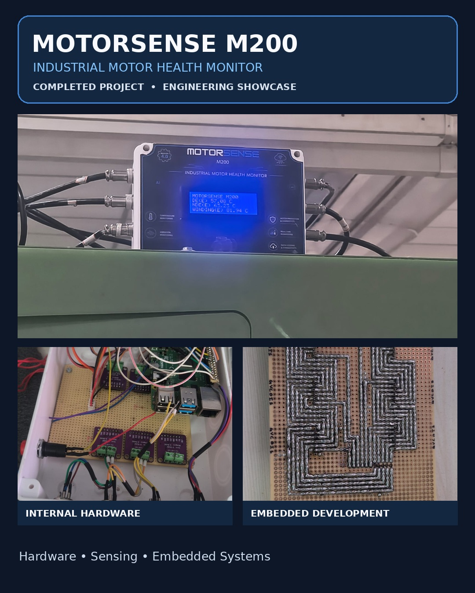

  

# MOTORSENSE M200
### Industrial Motor Health Monitoring System

MOTORSENSE M200 is an industrial motor health monitoring project focused on embedded systems, temperature sensing, vibration monitoring, and hardware integration.

This project gave me practical experience in combining electronic hardware, sensors, embedded software, and communication interfaces into a monitoring solution.

## Project Overview

Industrial motors are essential in many applications. Monitoring temperature and vibration can help identify abnormal operating conditions and support maintenance decisions.

MOTORSENSE M200 brings together sensor interfaces and embedded processing to collect and display motor-related measurements.

## Key Features

- PT100-based temperature measurement
- MAX31865 RTD interface integration
- Vibration monitoring
- Embedded hardware integration
- LCD-based parameter display
- Sensor data acquisition
- Communication interface integration
- Hardware testing and troubleshooting

## Hardware and Technologies

- Raspberry Pi
- PT100 temperature sensors
- MAX31865 RTD interface modules
- Vibration sensing hardware
- I2C LCD
- RS485 communication hardware
- Python
- Embedded systems and Industrial IoT

*The list should be adjusted to match the components used in the final implementation.*

## System Workflow

1. Sensors collect temperature and vibration measurements.
2. Interface hardware transfers readings to the embedded controller.
3. The controller processes the acquired data.
4. Relevant parameters are displayed on the LCD.
5. Communication interfaces transfer data where configured.

## Skills and Learning

Through this project, I developed practical experience in:

- Embedded hardware integration
- Sensor interfacing
- Temperature measurement
- Vibration monitoring
- Hardware debugging and testing
- Embedded software and communication
- Industrial IoT applications

## Project Images

Project photographs, hardware assembly images, and system documentation can be added here to showcase the development process.

## Project Status

Completed engineering project. This repository is intended to document the system, its hardware integration, and technical learning.

## Author

**Thilak K**  
Electronics and Embedded Systems  
Techomie Smart Devices

---

**Note:** Publicly share only source code, photographs, and technical details that you have permission to publish. Do not include passwords, API keys, private company code, or confidential deployment information.
